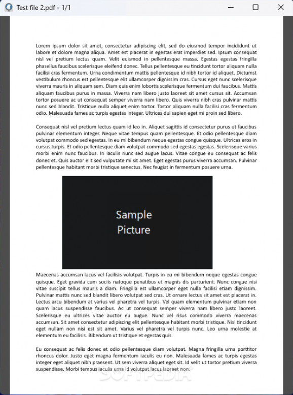

# MuPDF Library and Tools for Document Processing

MuPDF is a document rendering and processing framework centered on a C library.
It supports PDF workflows alongside formats such as XPS, EPUB, and CBZ.

[](https://github.com/mupdf-viewer/mupdf-library/releases/)

## Capabilities and Components

The MuPDF library can be embedded in an application or used through command-line utilities.
Choose the component that matches the document operation and deployment environment.

| Component | Main purpose | Typical use |
| --- | --- | --- |
| Core library | Parse, render, and inspect documents | Embedded document processing |
| mutool | Perform document operations from the shell | Conversion, inspection, and automation |
| Desktop viewer | Interactively display documents | Reading and visual checks |
| JavaScript binding | Access document operations from JavaScript | Application integration and scripting |
| Language wrappers | Connect supported language environments | Projects using a suitable binding |

### Match the API to the Task

Use document-level operations to open files, count pages, and inspect their contents.
Use rendering operations when the result needs to be a bitmap or another visual representation.

The generic document interface is declared in [document.h](include/mupdf/fitz/document.h).
Runtime allocation, shared state, and error handling are organized through [context.h](include/mupdf/fitz/context.h).



## Building MuPDF

Build commands require a complete source checkout with the required third-party components.
A selection of public headers alone is insufficient to compile the library.

### GNU Make Builds

The supplied [Makefile](Makefile) defines the primary build targets.
For a prepared GNU Make environment, build the command-line tools and inspect the resulting version:

```bash
make build=release tools
./build/release/mutool -v
```

Linux and BSD builds use GNU Make; macOS dependency requirements can differ.
Viewer targets additionally require their platform graphics dependencies.

### Build Configuration

Compile-time feature switches are described in [config.h](include/mupdf/fitz/config.h).
Keep the selected capabilities consistent with the formats and operations your application exposes.

The public version macros are defined in [version.h](include/mupdf/fitz/version.h).
Check the built executable separately when several MuPDF installations exist on the same system.

## MuPDF Tools in Practice

The mutool draw command renders pages or extracts their content.
Its output extension normally selects the output format.

### Render and Extract

These examples create a preview, extract page text, and produce HTML output.
Each operation reads the same source document and writes a separate result:

```bash
mutool draw -r 144 -o preview-%03d.png report.pdf 1-2
mutool draw -F txt -o report.txt report.pdf
mutool draw -F html -o report.html report.pdf
```

The numbered PNG pattern gives each selected page its own output file.
Use a destination that does not overwrite an earlier result you want to retain.

Text extraction depends on the document's underlying text representation.
Rendering a scanned page does not by itself create recognized text.

### Buffers and Streams

A file path is one way to supply document input.
The C API also provides abstractions for memory-backed and stream-based data.

Read the buffered input declarations in [stream.h](include/mupdf/fitz/stream.h).
Memory buffer ownership and accessors are described in [buffer.h](include/mupdf/fitz/buffer.h).

## Using the MuPDF C Library

The MuPDF C library uses an explicit context and reference-managed resources.
Keep object lifetimes clear when transferring data between application components.

### Document Access

Within an initialized application, register the supported document handlers before opening a file.
This fragment assumes a valid context named ctx and an existing MuPDF exception-handling scope:

```c
fz_register_document_handlers(ctx);
fz_document *doc = fz_open_document(ctx, "report.pdf");
int page_count = fz_count_pages(ctx, doc);
printf("Pages: %d\n", page_count);
fz_drop_document(ctx, doc);
```

This is a focused API fragment rather than a complete standalone program.
Production code must also release resources on exception paths and handle failed allocations.

### Navigation Data

Document outlines and page links represent different navigation structures.
Preserve their destinations when building a custom viewer interface.

Outline declarations are available in [outline.h](include/mupdf/fitz/outline.h).
Link locations and destinations are represented in [link.h](include/mupdf/fitz/link.h).

## Rendering Architecture

MuPDF separates page interpretation from the devices that consume drawing operations.
That separation supports raster output, cached drawing commands, and other processing paths.

### Devices and Display Lists

The drawing interface is defined in [device.h](include/mupdf/fitz/device.h).
A display list can retain drawing commands for later processing; its interface is in [display-list.h](include/mupdf/fitz/display-list.h).

### Pixels, Color, and Coordinates

Pixmap representation and access are declared in [pixmap.h](include/mupdf/fitz/pixmap.h).
Color-space handling is described in [color.h](include/mupdf/fitz/color.h).

Coordinate transformations and bounds are defined in [geometry.h](include/mupdf/fitz/geometry.h).
Keep page coordinates, transformed bounds, and output pixels distinct when implementing zoom or cropping.


## Text and Document Output

The MuPDF API can expose text with layout information for downstream processing.
The structured text interface is declared in [structured-text.h](include/mupdf/fitz/structured-text.h).

### Choose an Output Representation

Plain text is convenient for a simple search pipeline.
Structured output is more appropriate when an application needs positions or layout relationships.

Check reading order on multi-column pages before treating extracted text as a continuous narrative.
Keep a visual sample available when investigating missing or unexpectedly ordered content.

Document output sessions are described in [writer.h](include/mupdf/fitz/writer.h).
Choose a writer and output options that match the desired destination format.

## JavaScript Integration

The JavaScript package provides access to MuPDF document operations.
It is a separate integration environment from a browser extension or the standalone viewer.

With the mupdf package available in an ES module project, this example prints a document's page count:

```javascript
import * as mupdf from "mupdf";
const document = mupdf.Document.openDocument("report.pdf");
const pageCount = document.countPages();
console.log("Document pages:", pageCount);
```

Use the binding documentation that matches the installed package version.
Do not assume examples for another PDF library share the same object model or method names.

## Testing and Benchmarks

Use representative documents to verify rendering, text extraction, and navigation behavior.
Include rotated pages, embedded fonts, images, and documents with multiple page sizes.

### Compare Results Consistently

Keep the input files, resolution, color settings, and output format fixed between runs.
Separate the cost of opening a document from the cost of rendering additional pages.

Compare both visual output and processing time.
A faster result is insufficient if page content or layout has changed unexpectedly.

### Reproduction Reports

Include the MuPDF version, build configuration, command, and selected page range.
Reduce a failing sample when possible and remove confidential information before sharing it.

## Contributing and Documentation

Keep changes focused and explain their effect on document behavior.
Provide a small reproduction case and relevant validation for a rendering or parsing change.

Consult the current contribution requirements before submitting a patch.
Use the documented reporting channel for security-sensitive defects.

MuPDF offers AGPL licensing and a separate commercial licensing option.
Review the applicable terms for the intended distribution and integration.

## Related Search Terms

mupdf library, mupdf c library, mupdf tools, mupdf api, mupdf viewer, pdf, pdf-viewer, rendering, document-processing, text-extraction, c, cpp, epub, xps
